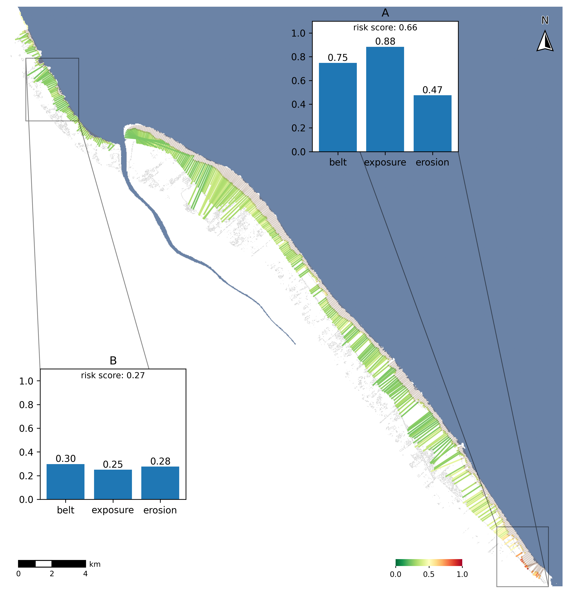

# Mangrove Mapper

A multi-layered framework for mangrove risk assessment and hindcast validation in Guyana.

## Project Overview
This package is a model pipeline that builds extent maps for a given available year, develops a risk index based on various risk factors such as fringe width, remote sensing indices, erosion, and generates hindcasts to validate mangrove vulnerability areas within a coastline.

Extent maps come from an XGBoost classifier on fused Landsat 8, Sentinel-2, Sentinel-1 and ALOS PALSAR features, trained on Global Mangrove Watch 2020 labels and assessed with the stratified estimator of Olofsson et al. (2014) against interpreted reference plots.

### Risk Assessment Example Output



## Project Structure

```
mangrove-mapper-guyana/
├── mangrove_mapper/                    # the installable package
│   ├── __init__.py
│   ├── main.py                         # MangroveMapper: GEE auth, sampling, tiled exports
│   ├── inference.py                    # windowed prediction (predict_tile / extent_tile)
│   ├── visualize.py
│   ├── configs/
│   │   ├── config.yml                  # AOIs, bands, risk weights, hindcast geometry
│   │   └── indices.yml                 # spectral / SAR index expressions
│   ├── sensors/
│   │   ├── __init__.py
│   │   ├── base.py                     # SensorProcessor: load / preprocess / composite
│   │   ├── landsat8.py
│   │   ├── sentinel1.py                # orbit-aware (ASCENDING / DESCENDING)
│   │   ├── sentinel2.py                # level-aware (SR / TOA)
│   │   └── alos_palsar.py
│   ├── models/
│   │   ├── __init__.py
│   │   └── mangrove_classifier.py      # RF / XGB wrapper, tuning, spatial CV
│   ├── risk/
│   │   ├── __init__.py
│   │   ├── geometry.py                 # coastline tracing, shore-normal transects
│   │   ├── measure.py                  # per-transect belt / exposure / erosion measurement
│   │   ├── index.py                    # risk index
│   │   └── compose.py                  # build_factors / compose_index aggregators
│   ├── validation/
│   │   ├── interpreter.py              # blind plot-labelling widget (Planet basemaps)
│   │   └── validator.py                # evaluate_model, olofsson_estimate
│   ├── utils/
│   │   ├── fusion.py                   # concat_sensors, load_target
│   │   ├── raster.py                   # mosaicking, windowing, VRT helpers
│   │   ├── download.py                 # Drive polling and retrieval
│   │   ├── regions.py                  # Guyana administrative regions
│   │   ├── refined_lee.py              # SAR speckle filter
│   │   └── to_db.py
│   └── accuracy_assessment/
│       ├── region_2_accuracy_assessment_final.csv     # 400 plots (Pomeroon)
│       ├── full_coast_accuracy_assessment_final.csv   # 600 plots (coast-wide)
│       ├── ceo-coastwide-interpretations-plot-data-2026-08-14.csv
│       └── reference-audit-narei.ipynb                # model-blind reference audit
│
├── tests/
│   ├── test_sensors.py
│   ├── test_fusion.py
│   ├── test_inference.py
│   ├── test_mangrove_classifier.py
│   ├── test_regions.py
│   └── test_validator.py
│
├── reports/
│   ├── final-report/
│   │   ├── final-report.tex            # the thesis
│   │   ├── references.bib
│   │   ├── report-template.cls
│   │   ├── Makefile                    # TEXINPUTS=".." -- paths resolve from reports/
│   │   ├── hindcast_pipeline.ipynb     # 2016-2018 Region 5 hindcast + risk overlay
│   │   ├── region2_results.ipynb       -> tables/region2_results.tex, figures/region2_extent_fig.png
│   │   ├── coastwide_results.ipynb     -> tables/coastwide_results.tex, figures/coastwide_extent_fig.png
│   │   ├── figures/
│   │   │   ├── regions_map.py            -> regions_map_fig.png
│   │   │   ├── spatial_cv.py             -> spatial_cv_fig.png
│   │   │   ├── risk_index_figures.ipynb  -> risk_index_figure{1,2}.png
│   │   │   ├── hindcast_pipeline_fig.png  (from ../hindcast_pipeline.ipynb)
│   │   │   ├── irp-data-flowchart.drawio[.png]
│   │   │   └── NAREI Drone Imagery{, 2, 3}.jpeg   (supplied, not generated)
│   │   └── tables/
│   │       ├── confusion_matrices_appendix.ipynb
│   │       │      -> confusion_matrices_appendix_{region2,coastwide}.tex
│   │       └── hindcast_pipeline_tab.tex
│   └── project-plan/
│       ├── project-plan.tex
│       ├── references.bib
│       ├── report-template.cls
│       ├── Makefile
│       └── figures/IRP Gantt Chart.{xlsx,pdf}
│
├── docs/
│   ├── references.md                   # bibliography, documentation links, AI-usage log
│   ├── CONTRIBUTING.md
│   └── pipeline/phase1_flowchart.{excalidraw,png}
│
├── sandbox/                            # exploratory work, not maintained (see sandbox/README.md)
│   ├── notebooks/
│   │   ├── exploratory_gee.ipynb
│   │   ├── exploratory_sar.ipynb
│   │   ├── cloud_coverage.ipynb
│   │   └── world_cover.ipynb
│   ├── accuracy_assessment/region_2_pomeroon.csv
│   └── figures/
│       ├── Regions of Guyana.jpg
│       └── Regions of Guyana ArcGISPro/    # ArcGIS Pro project + file geodatabases
│
├── .github/
│   └── workflows/                      # lint and pytest checks
│       ├── lint_checks.yml
│       └── pytest_tests.yml
│
├── logbook/                            # logbook.md
│
├── pyproject.toml
├── README.md
├── CITATION.cff
├── LICENSE
└── .gitignore
```


## Docs
- `docs/` covers contributing, references and pipeline design.
- `reports/final-report/README.md` explains how to regenerate the report's figures and tables.
- New to Google Earth Engine (GEE)? Start with the [access guide](https://developers.google.com/earth-engine/guides/access). You need a Google Cloud project registered for Earth Engine.

## Installation

1. Clone the repository

```bash
git clone https://github.com/madebyzu/mangrove-mapper-guyana.git
cd mangrove-mapper-guyana
```

2. Create and activate a Virtual Environment
Install conda to run the following cell

```bash
conda create -n [CONDA_ENV] python=3.12  # any version from 3.10 to 3.14
conda activate [CONDA_ENV]
```

3. Install Dependencies/ the package

```bash
pip install -e .
```

4. Install Optional Development Tools

For only running notebooks and figures

```bash
pip install ".[notebook]"
```

5. Testing and formatting

To install pytest and formatters like ruff:

```bash
pip install ".[test]"
```

With pytest installed, the tests can be run with:

```bash
python -m pytest
```

On macOS, XGBoost needs the OpenMP runtime (`brew install libomp`, or install `xgboost` from conda-forge).

## Usage

The pipeline runs in four steps. Earth Engine does the heavy sampling and exporting server side; training, inference and accuracy assessment run locally.

```python
import ee
import pandas as pd

from mangrove_mapper import MangroveMapper
from mangrove_mapper.models import MangroveClassifier
from mangrove_mapper.utils.regions import tag_regions

ee.Authenticate()
mm = MangroveMapper(project_name="your-gee-project")
mc = MangroveClassifier()

# 1. Export training samples (GMW 2020 labels, 2020 imagery), stratified by
#    class, then tag each with its region
mm.get_sensor_data("training_data", presence_only=True)
train = tag_regions(pd.read_csv("data/training_data.csv"),
                    regions_data_path="data/guyana_regions.geojson")

# 2. Train with leave-one-region-out tuning and save the model
model, params = mc.build_final_model(mc.features_except(train), train.label.values,
                                     groups=train.region.values, base_estimator="xgboost",
                                     param_dist=mc.XGB_PARAMS_DIST)
mc.save_model(model, "xgb_gmw", best_params=params)
```

3. **Map.** Export the inference-year feature stack as tiles with `mm.export_image_tiled`, pinned to one grid with `mm.pinned_transform()`. Then run `predict_tile` and `extent_tile` on each tile and stitch them with `mosaic` (all in `mangrove_mapper.inference`).

4. **Assess accuracy.** `evaluate_model` reads the map at each reference plot, and `olofsson_estimate` gives user's and producer's accuracy and the error-adjusted area (`mangrove_mapper.validation.validator`). `reports/final-report/tables/coastwide_results.ipynb` and `region2_results.ipynb` show the full workflow.

The plot-labelling widget (`mm.run_interpretation_widget`) needs Planet NICFI basemaps in your own GEE project. Planet's licence does not allow sharing them, so set `validation.collection_path` in `mangrove_mapper/configs/config.yml` or pass `collection_path=`.

## Data and Models

The reference plots used for accuracy assessment are in `mangrove_mapper/accuracy_assessment/`. The extent maps, risk layers, trained models and training samples are too large for the repository and will be archived on Zenodo alongside the paper (DOI to be added).

## Citation

If you use this software, please cite it using the metadata in [`CITATION.cff`](CITATION.cff) (GitHub's "Cite this repository" button).

## License

MIT. See [`LICENSE`](LICENSE).
